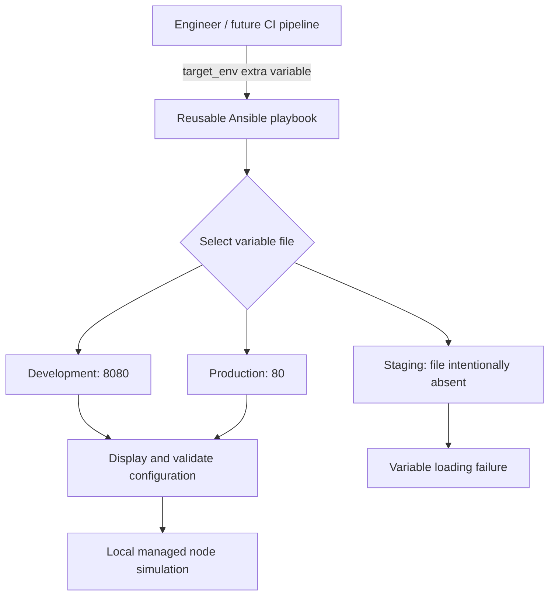

# Ansible Infrastructure Automation

A hands-on portfolio project for building reusable, multi-environment infrastructure automation. All current labs run locally and simulate deployment; they do not install Nginx.

## Business problem
Avoid duplicated playbooks, configuration drift and manual environment selection errors.

## Current architecture



## Repository layout
```text
inventory.ini
variables_lab.yml
reusable_lab.yml
vars/
  development.yml
  production.yml
.gitignore
README.md
```

## Prerequisites
Linux or WSL, Python 3 at /usr/bin/python3 (adjust inventory if needed), Git and ansible-core.

## Revision guide
| Concept | Explanation |
|---|---|
| Inventory | Defines managed hosts and connection settings |
| Control node | Runs Ansible and orchestrates tasks |
| Module | Implements a task, such as command or debug |
| register | Stores a task result dictionary, including stdout and rc when provided |
| changed_when | Controls whether a task reports changed |
| when | Conditionally executes or skips a task |
| assert | Fails a task when a required condition is false; all listed conditions must pass |
| vars | Defines play variables |
| -e | Extra variables override play variables for the current run |
| vars_files | Loads external YAML configuration |
| Jinja2 | Resolves expressions such as `{{ target_env }}` |
| in | Checks membership in a collection |

Avoid reserved variable names such as environment. Use deployment_env instead. Syntax checks do not guarantee runtime correctness.

## Lab 1: Variables and precedence
```bash
ansible-playbook -i inventory.ini variables_lab.yml --syntax-check
ansible-playbook -i inventory.ini variables_lab.yml
ansible-playbook -i inventory.ini variables_lab.yml -e "deployment_env=production"
```
The learner verified the normal run (ok=2, changed=0, failed=0) and the intentional override failure (ok=1, failed=1). Extra vars do not rewrite YAML.

## Lab 2: Dynamic variable selection
```bash
ansible-playbook -i inventory.ini reusable_lab.yml -e "target_env=development"
ansible-playbook -i inventory.ini reusable_lab.yml -e "target_env=production"
ansible-playbook -i inventory.ini reusable_lab.yml -e "target_env=staging"
```
Expected: development port 8080, production port 80, staging fails because its file is absent. Runtime verification pending. target_env selects the file; deployment_env identifies its configuration. The assertion checks membership and matching identity, not file existence. File loading happens before task validation. For production, validate untrusted selectors before dynamic file inclusion and restrict extra variables and deployment permissions.

## Progress
- [x] Inventory, ad hoc commands, playbooks, register, debug, when, assert
- [x] Variables and extra-variable precedence
- [ ] Dynamic variable selection: practical verification
- [ ] Inventory group_vars and host_vars
- [ ] Facts, loops and dictionaries
- [ ] Packages, services, files and permissions
- [ ] Roles, templates and handlers
- [ ] Error handling, Vault, idempotency
- [ ] CI/CD, tests and incident simulation

## Security
Public learning repository: never commit credentials, private keys, office configurations or real infrastructure identifiers. Production architecture and CI/CD are future work, not implemented yet.
